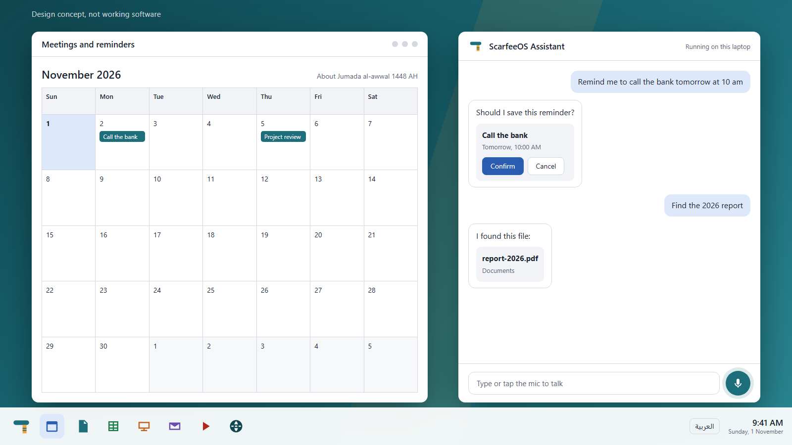
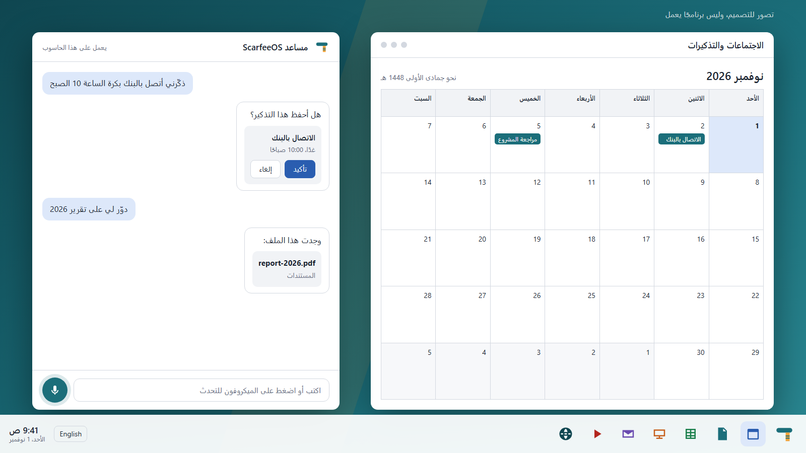

# ScarfeeOS

An AI-first operating system for laptops. Talk to it or type to it, in **English or Arabic**.

> Status: early development. The assistant and its panel run on a development machine, but there is no installable system yet. See [where things stand](docs/lifecycle.md#where-things-stand).

## Design

*Design concept of the desktop in English and Arabic, not working software.* See [docs/design.md](docs/design.md) for real screenshots of what works today, the design principles and the visual language.

## Vision

- **AI voice and text agent** built into the system. It opens apps, manages files, schedules meetings and helps with tasks.
- **Bilingual from the first boot:** English and Arabic are both main languages. The installer asks which one to use before anything else, and the language can be switched later without a restart. Arabic is fully right-to-left (RTL) across the shell, apps, speech and the AI.
- **Smooth desktop**, familiar to Windows and Fedora users.
- **Built-in apps:** documents, spreadsheets, presentations, email and calendar, a media player, a meetings and scheduling manager, and a web browser.
- **Runs on business laptops** (Ryzen or Intel, with or without a GPU). Local-first AI, with an optional Claude connection for users who want it.

## Approach

ScarfeeOS is a Linux-based system (Fedora as the base), not a new kernel. See [docs/architecture.md](docs/architecture.md).

## Repository layout

| Path | Purpose |
|------|---------|
| `core/` | Rust AI service: model providers, speech, task/tool API |
| `shell/` | Desktop shell (Tauri UI, Wayland compositor integration) |
| `apps/` | Productivity apps, media player, browser, meetings manager |
| `os-image/` | Fedora-based image build and the installer |
| `locales/` | Translations (`en`, `ar`) in Fluent format |
| `docs/` | Architecture, installer, Arabic/i18n rules, [lifecycle](docs/lifecycle.md), [models](docs/models.md), [voice options](docs/voice-options.md), [productivity apps](docs/productivity-apps.md) |

## Languages

English and Arabic are required for every user-facing feature. See [docs/i18n-and-arabic.md](docs/i18n-and-arabic.md).

## Project lifecycle

| Stage | Status |
|-------|--------|
| 1. Foundations | Done |
| 2. AI core | Mostly done |
| 3. Speech | In progress |
| 4. Desktop shell and first apps | In progress |
| 5. Bootable image | In progress |
| 6. Productivity apps | Not started |
| 7. Hardware and alpha testing | Not started |
| 8. Legal review | Not started, kept until a working product exists |
| 9. Beta and first release | Not started |
| 10. Maintenance | Not started |

**Current agenda:** resolve a voice that meets the licensing policy, test the microphone, the desktop window and the AI tiers on real hardware, then build and boot the first image. A build script exists, but no image has been built yet.

Full details, including what each stage requires and what is not proven yet: [docs/lifecycle.md](docs/lifecycle.md). Task-level detail: [ROADMAP.md](ROADMAP.md).

## Legal

The project follows a strict IP and licensing policy: [docs/ip-and-licensing.md](docs/ip-and-licensing.md).

## License

Apache-2.0. See [LICENSE](LICENSE) and [NOTICE](NOTICE). Created and led by Asem Y Saad, with contributions welcome: see [CONTRIBUTING.md](CONTRIBUTING.md). Contributions require DCO sign-off (`git commit -s`).
