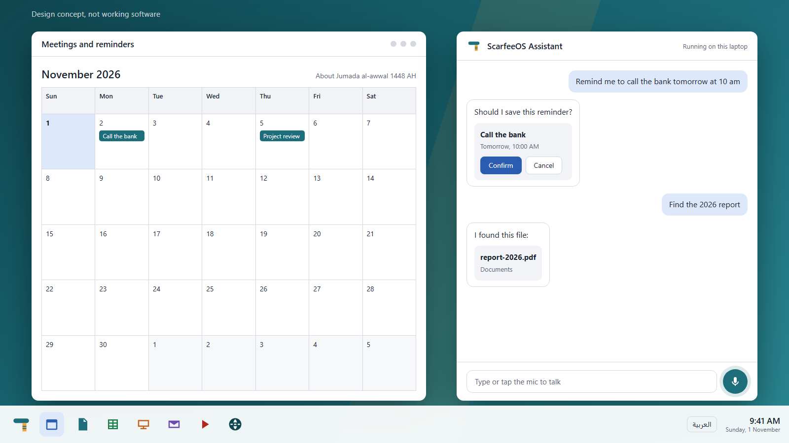
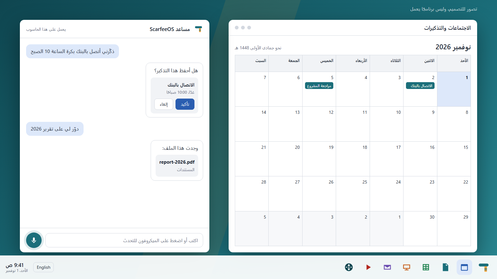
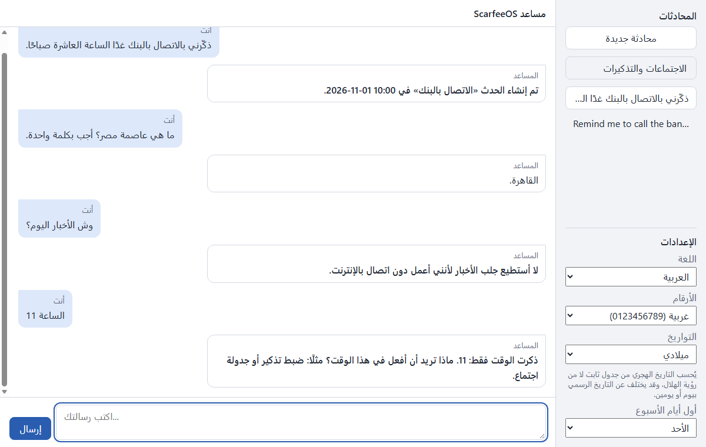
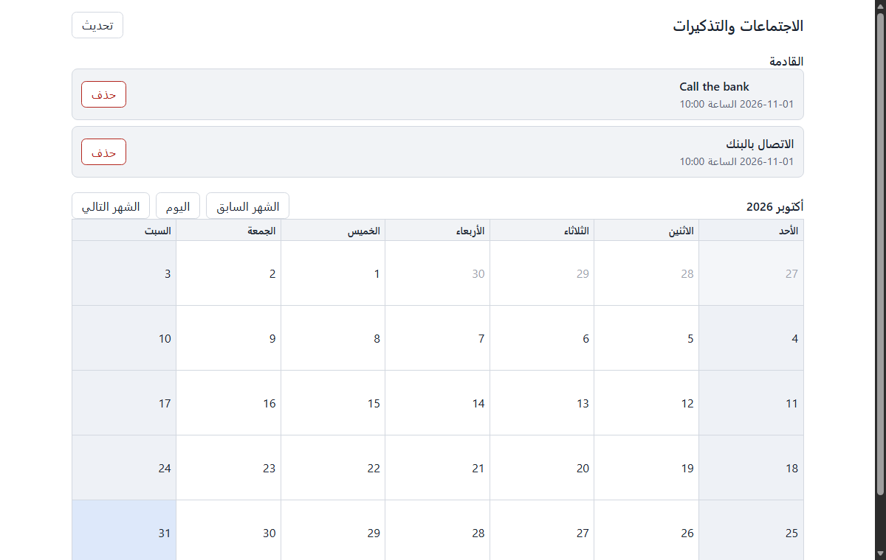
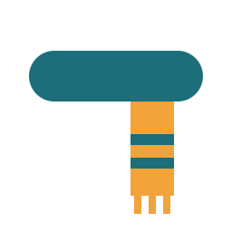

# Design

How ScarfeeOS will look and behave. The first two images are a **concept**, not working software. The screenshots further down are real screens from the current development version. The design will change as it is tested with real users.

## The desktop (concept)

English, left to right:

Arabic, mirrored from right to left:

The concept shows the intended desktop:
- **Assistant panel:** always one tap away. You type or use the microphone, in either language, and it tells you it runs on your laptop.
- **Taskbar:** the ScarfeeOS logo, then the calendar, documents, spreadsheets, presentations, email, media player and browser, with the language switch and clock at the other end.
- **Actions you can check:** before a risky change, the assistant shows what it will do, with Confirm and Cancel.

The concept's desktop and taskbar are not built yet. Its one-window session may also need to change: the image currently plans a single-window kiosk session, which cannot show several app windows side by side like this concept does.

## Working today

These are real screenshots. The assistant runs a local model on the laptop.

### Assistant panel

It has conversations, a live language switch, a choice of Western or Eastern Arabic digits, and optional Hijri dates. Everything mirrors with the language, without a restart.

### Meetings and reminders

It has upcoming events, a month view, delete with confirmation, and a choice of week start and weekend days. Hijri dates are shown as approximate.

## Principles

1. **Two languages, equally.** Arabic is not a translation layer. The whole layout mirrors, and Arabic text, English terms, numbers and file names display correctly together. See [i18n-and-arabic.md](i18n-and-arabic.md).
2. **Familiar, not copied.** Standard ideas such as a taskbar, menus and windows, with an original look. No names, logos or designs from other products. See [ip-and-licensing.md](ip-and-licensing.md).
3. **Honest about what happened.** The assistant says what it did, what it could not do, and when a result is approximate. It never pretends an action ran.
4. **You stay in control.** Settings changes and unclear requests ask first.
5. **Calm and readable.** Plain surfaces, generous spacing, and text that is comfortable to read in both scripts.

## Visual language

| Element | Choice |
|---------|--------|
| Primary color | Deep teal, `#1b6e7a` |
| Accent | Warm amber, `#f2a33a` |
| Actions and focus | Blue, `#2a5db0` |
| Text | Near-black, `#1c2330`, and muted slate, `#5a6577` |
| Surfaces | White and light gray, `#f1f3f6` |
| Arabic fonts | Noto Naskh Arabic, Noto Sans Arabic and IBM Plex Arabic |
| Shapes | Rounded corners, with soft shadows on windows |

### Logo

An original mark: a scarf wrapped around, with one end hanging down.

## Not designed yet

Dark mode, the boot and login screens, the productivity apps, and how the voice experience looks while the assistant is listening and speaking.
